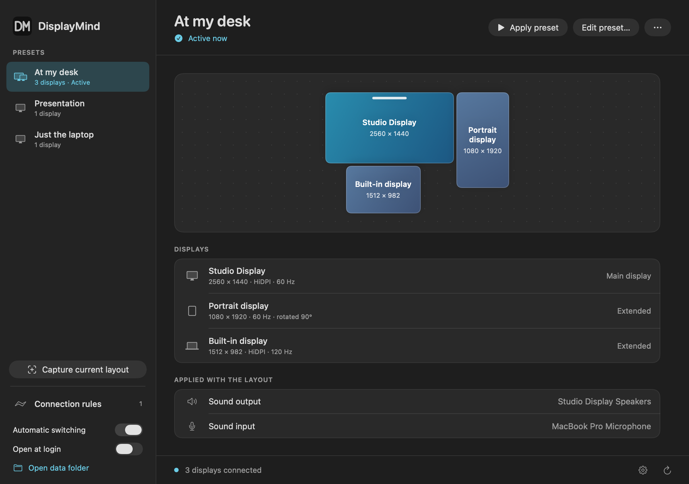

# DisplayMind

A small native macOS app for display presets and connection-based defaults.




- Capture the current arrangement, then edit rotation, resolution, refresh rate, main display, extended positions, and mirroring.
- Switch presets from the window or menu bar.
- Connect a saved AirPlay receiver before applying a preset, including from connection rules.
- Apply a default when selected displays or USB docks/devices are connected or absent.
- Arrange rule priority; require an exact display set or allow extra displays.
- Preview changes with a 20-second Keep/Revert countdown and a separate rollback process.
- Optionally launch at login. Closing the window leaves the menu-bar app running.

## Use

Open DisplayMind and choose **Capture current**. Give the preset a name, adjust the layout, and save it. **Apply preset** offers a timed confirmation. Capturing an unchanged current layout also marks it ready for automatic rules.

In **Connection rules**, choose a preset and mark each relevant display or USB device **Connected** or **Absent**. All conditions must match. The first eligible rule wins after connections settle for three seconds. Rules also run on launch and wake. A manually selected preset remains active until the next connection change, wake, or rule change. Automatic switching can be paused in the sidebar or menu bar.

[Layout editor](docs/preset-editor.png) · [Connection rules](docs/connection-rules.png) · [Rule editor](docs/rule-editor.png)

An edited preset must be applied and kept once before it can run automatically. Automatic applications verify the resulting configuration and revert on failure. Newly connected USB devices appear automatically. Previously selected devices remain available in the rule editor after disconnecting.

## AirPlay

Capture a layout while the receiver is connected through macOS Screen Mirroring. In the preset editor, enable **Connect AirPlay when applying this preset**, choose the **Saved AirPlay display**, and select the receiver with **Find receivers** or enter its exact Screen Mirroring name. Find receivers briefly opens Control Center; it does not start streaming.

[AirPlay preset editor](docs/airplay-editor.png)

**Allow AirPlay control** opens the macOS Accessibility permission settings. Enable DisplayMind there to allow it to use Screen Mirroring controls. This permission is required only when establishing or undoing an AirPlay connection; an existing stream is reused. Receiver pairing codes and macOS approval prompts remain under your control.

Applying the preset connects the receiver, waits up to 30 seconds for its saved display to appear, then applies the arrangement and presents Keep/Revert. Rollback disconnects a stream started by that change before restoring the previous layout, including if the app exits. Streams that were already connected remain connected. Switching to a preset without AirPlay does not disconnect existing streams.

Connection rules can trigger while the preset’s AirPlay display is offline. Use a dock or another display as the connection condition; an explicit condition requiring the AirPlay display to be connected still means it must already be connected. An AirPlay connection made by DisplayMind does not immediately trigger another rule.

Control Center must expose its Screen Mirroring controls to Accessibility. Device selection uses an exact saved control identifier or an unambiguous exact name; DisplayMind never falls back to an arbitrary receiver. If macOS changes a control or a saved display identity, the app reports the problem and recovers instead of guessing. This feature controls screen streaming, not audio-only AirPlay or Sidecar.

## Build

Requires macOS 13 or later and Xcode Command Line Tools with Swift 5.9 or later. The app and helper build for the current Mac's architecture. No downloaded packages, Homebrew, or network access are needed for building after cloning.

```sh
tools/preflight.sh
tools/install.sh
open /Applications/DisplayMind.app
```

The output is `dist/DisplayMind.app`. Signing: `DISPLAYMIND_SIGNING_IDENTITY` if set (`-` forces ad hoc); otherwise the login keychain's only `Developer ID Application` identity, with hardened runtime and a secure timestamp; otherwise ad hoc. A stable identity keeps the Accessibility grant across rebuilds (an ad-hoc signature changes each build). The build prints which kind was used. This repository does not provide a notarized distribution. A debug build is available with `tools/build.sh debug`.

`tools/install.sh [dir]` installs into `/Applications` or `dir`, updating an existing copy in place. It refuses while a display change is pending, quits a running app (and relaunches it), and keeps the previous bundle until the new one passes `--diagnostics`, restoring it otherwise.

Release: `tools/tdtp.sh` (full preflight) or `tools/dtp.sh` (build, `--diagnostics`, watchdog check) from a clean `main`. It bumps the minor version and build number (or reuses an untagged bump), commits, tags `vX.Y.0`, pushes atomically, installs, and reports to the status page. `--dry-run` prints the mutating commands.

## Storage and privacy

Settings live in the visible `~/DisplayMind/settings.json` folder. The app has no analytics or account. Display UUIDs, USB identities, and AirPlay receiver selections stay in local settings. macOS handles the network connection and screen streaming when AirPlay is selected. **Open data folder** reveals local settings. Invalid or newer settings files are preserved and reported instead of silently reset. Existing presets without an AirPlay setting retain their behavior.

During a pending change, `pending-change.json` holds the previous configuration. A separate watchdog restores it when the deadline expires, even if the UI exits. A failed rollback retains a `restoring-*.json` snapshot and records the failure. Reopening the app resumes recovery for an interrupted pending change.

## Compatibility

Display control uses a bundled build of [displayplacer 1.4.0](https://github.com/jakehilborn/displayplacer/tree/v1.4.0), under its MIT license. Rotation relies on Apple's private MonitorPanel framework. Available modes, rotation, and mirroring depend on macOS and the display/driver; rejected settings trigger recovery. The editor shows modes reported for the current orientation and transposes dimensions when rotated. macOS can reject a particular rotated mode.

Mirrored displays share their source's rotation, resolution, and position. AirPlay presets can initiate their saved receiver connection; other displays must already be connected. Display UUIDs normally persist but can change with some docks, adapters, or macOS updates; capture the layout again if macOS assigns a new identity. USB devices without serial numbers are identified by vendor, product, and port, so moving one to another port requires updating its rule. Display disabling is not offered in the editor; an already disabled display is preserved when captured.

## Development

`DisplayMindCore` contains configuration validation, displayplacer parsing, rule matching, connection settling, and JSON storage. `DisplayMind` contains SwiftUI, the USB registry reader, process execution, and rollback watchdog. Vendor provenance and modifications are recorded in `Vendor/displayplacer/ORIGIN.md`.

Preflight builds the app, runs the full fixture-based suite, verifies the bundle and version, and performs read-only diagnostics against connected hardware. Tests never change live display settings. To render the interface offscreen with synthetic data:

```sh
dist/DisplayMind.app/Contents/MacOS/DisplayMind --render-preview /tmp/displaymind.png
```

Add `--rules`, `--editor`, or `--rule-editor` for the other views, and `--airplay` to preview an AirPlay preset. No desktop window is shown during rendering. Automated tests use fake connection controls and never start or stop a real AirPlay stream.

The silver DM mark uses MindSuite's charcoal tile, rounded 9-unit strokes, and 96-unit grid. Vector originals are in `assets/logo.svg` and `assets/logo-square.svg`; `tools/generate-icon.swift` generates the PNG, menu-bar PDF, and iconset used by the app.
